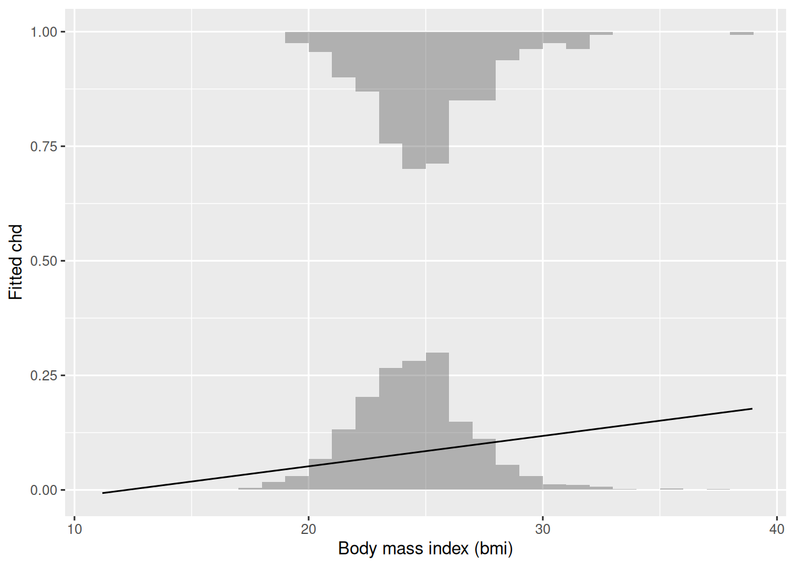
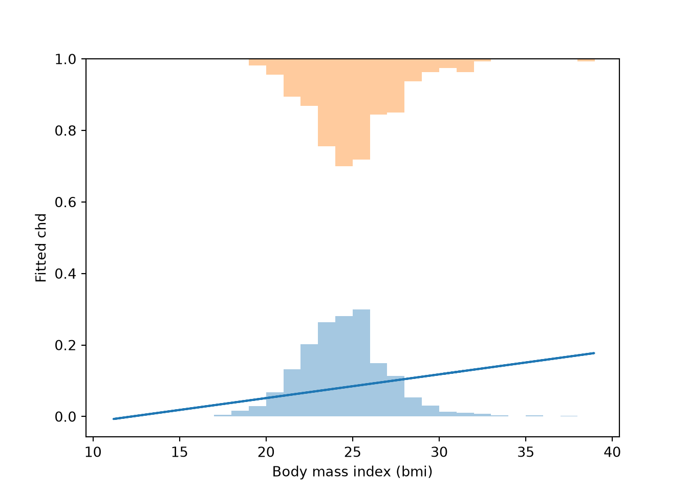

# Plotting a Binary Outcome

Code

Published

Last modified: 2026-10-19 03:20:06 (PDT)

## 0.1 Why a scatterplot fails

An outcome that takes only the values 0 and 1 puts every point of a scatterplot on one of two horizontal stripes. Dots on the same stripe overlap wherever the feature takes similar values, so the plot hides how many observations there are. Two plots avoid this: a rug and a pair of histograms.

The examples use the Western Collaborative Group Study, which followed 3154 middle-aged men for coronary heart disease ([Rosenman et al. 1975](#ref-rosenman1975coronary)). In `data/wcgs.csv`, the outcome `chd` is 1 for a man with an incident case and 0 for a man without one. The feature is his body mass index, `bmi`. Each plot also shows the line fitted to `chd` by least squares on `bmi`.

## R

``` r
wcgs <- readr::read_csv("data/wcgs.csv", show_col_types = FALSE)
fit_bmi <- lm(chd ~ bmi, data = wcgs)
```

## Python

``` python
import numpy as np
import pandas as pd

wcgs = pd.read_csv("data/wcgs.csv")
slope, intercept = np.polyfit(wcgs["bmi"], wcgs["chd"], 1)
fitted_bmi = intercept + slope * wcgs["bmi"]
```

## 0.2 A rug

> **NOTE:**
>
> **Example 1 (A rug of the WCGS outcome)** A rug draws one tick per observation along an axis. Draw the men with `chd` \\= 0\\ along the bottom edge and the men with `chd` \\= 1\\ along the top edge. Transparent ticks darken where many observations share nearly the same `bmi`.
>
> ## R
>
> ``` r
> library(ggplot2)
> ggplot(wcgs, aes(bmi, chd)) +
>   geom_rug(data = subset(wcgs, chd == 0), sides = "b", alpha = 0.3) +
>   geom_rug(data = subset(wcgs, chd == 1), sides = "t", alpha = 0.3) +
>   geom_hline(yintercept = c(0, 1), linetype = "dashed") +
>   geom_line(aes(y = fitted(fit_bmi))) +
>   labs(x = "Body mass index (bmi)", y = "Fitted chd")
> ```
>
> [](binary-outcomes_files/figure-html/unnamed-chunk-4-1.png "Fitted line of chd on bmi in the WCGS data, with a rug of the men with chd = 1 along the top and chd = 0 along the bottom.")
>
> Fitted line of `chd` on `bmi` in the WCGS data, with a rug of the men with `chd` = 1 along the top and `chd` = 0 along the bottom.
>
> ## Python
>
> ``` python
> import matplotlib.pyplot as plt
>
> fig, ax = plt.subplots()
> for chd, side in [(0, 0.0), (1, 1.0)]:
>     bmi_chd = wcgs.loc[wcgs["chd"] == chd, "bmi"]
>     ax.plot(bmi_chd, [side] * len(bmi_chd), "|", color="gray", alpha=0.3)
> ax.axhline(0, linestyle="--", color="black")
> ax.axhline(1, linestyle="--", color="black")
> ax.plot(wcgs["bmi"], fitted_bmi)
> ax.set_xlabel("Body mass index (bmi)")
> ax.set_ylabel("Fitted chd")
> plt.show()
> ```
>
> [](binary-outcomes_files/figure-html/unnamed-chunk-5-1.png "Fitted line of chd on bmi in the WCGS data, with a rug of the men with chd = 1 along the top and chd = 0 along the bottom.")
>
> Fitted line of `chd` on `bmi` in the WCGS data, with a rug of the men with `chd` = 1 along the top and `chd` = 0 along the bottom.

## 0.3 Two histograms

> **NOTE:**
>
> **Example 2 (Two histograms of the WCGS feature)** A histogram of `bmi` for the men with `chd` \\= 0\\ stands on the line \\y = 0\\. A histogram for the men with `chd` \\= 1\\ hangs down from the line \\y = 1\\. Each histogram is scaled so its tallest bar is \\0.3\\ high, because there are far fewer cases than non-cases and the raw counts would hide the smaller group. The heights then show each group’s shape, not how many men it holds.
>
> ## R
>
> ``` r
> breaks <- seq(floor(min(wcgs$bmi)), ceiling(max(wcgs$bmi)), by = 1)
> bars <- function(data, chd_value) {
>   counts <- hist(data$bmi[data$chd == chd_value], breaks = breaks,
>                  plot = FALSE)$counts
>   tibble::tibble(xmin = head(breaks, -1), xmax = tail(breaks, -1),
>                  height = 0.3 * counts / max(counts))
> }
> bars0 <- bars(wcgs, 0)
> bars1 <- bars(wcgs, 1)
> ggplot(wcgs, aes(bmi, chd)) +
>   geom_rect(data = bars0,
>             aes(xmin = xmin, xmax = xmax, ymin = 0, ymax = height),
>             inherit.aes = FALSE, alpha = 0.4) +
>   geom_rect(data = bars1,
>             aes(xmin = xmin, xmax = xmax, ymin = 1 - height, ymax = 1),
>             inherit.aes = FALSE, alpha = 0.4) +
>   geom_line(aes(y = fitted(fit_bmi))) +
>   labs(x = "Body mass index (bmi)", y = "Fitted chd")
> ```
>
> [](binary-outcomes_files/figure-html/unnamed-chunk-6-3.png "The same line, with a histogram of bmi for the men with chd = 0 standing on the line y = 0 and one for the men with chd = 1 hanging from the line y = 1. Each histogram is scaled so its tallest bar is 0.3 high.")
>
> The same line, with a histogram of `bmi` for the men with `chd` = 0 standing on the line y = 0 and one for the men with `chd` = 1 hanging from the line y = 1. Each histogram is scaled so its tallest bar is 0.3 high.
>
> ## Python
>
> ``` python
> breaks = np.arange(np.floor(wcgs["bmi"].min()), np.ceil(wcgs["bmi"].max()) + 1)
>
> fig, ax = plt.subplots()
> for chd, base, sign in [(0, 0.0, 1), (1, 1.0, -1)]:
>     counts, _ = np.histogram(wcgs.loc[wcgs["chd"] == chd, "bmi"], bins=breaks)
>     ax.bar(breaks[:-1], sign * 0.3 * counts / counts.max(), width=1,
>            bottom=base, align="edge", alpha=0.4)
> #> <BarContainer object of 28 artists>
> #> <BarContainer object of 28 artists>
> ax.plot(wcgs["bmi"], fitted_bmi)
> #> [<matplotlib.lines.Line2D object at 0x7f77f809e210>]
> ax.set_xlabel("Body mass index (bmi)")
> #> Text(0.5, 0, 'Body mass index (bmi)')
> ax.set_ylabel("Fitted chd")
> #> Text(0, 0.5, 'Fitted chd')
> plt.show()
> ```
>
> [](binary-outcomes_files/figure-html/unnamed-chunk-7-1.png "The same line, with a histogram of bmi for the men with chd = 0 standing on the line y = 0 and one for the men with chd = 1 hanging from the line y = 1. Each histogram is scaled so its tallest bar is 0.3 high.")
>
> The same line, with a histogram of `bmi` for the men with `chd` = 0 standing on the line y = 0 and one for the men with `chd` = 1 hanging from the line y = 1. Each histogram is scaled so its tallest bar is 0.3 high.

# References

Rosenman, Ray H, Richard J Brand, C David Jenkins, Meyer Friedman, Reuben Straus, and Moses Wurm. 1975. “Coronary Heart Disease in the Western Collaborative Group Study: Final Follow-up Experience of 8 1/2 Years.” *JAMA* 233 (8): 872–77. <https://doi.org/10.1001/jama.1975.03260080034016>.

Back to top
